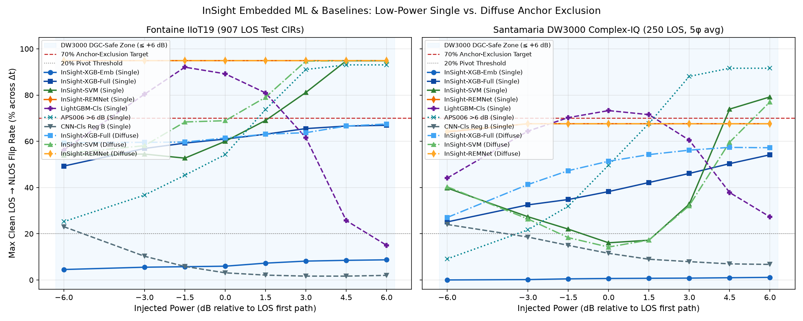

# Phantom NLOS: Sub-Direct-Path UWB CIR False-NLOS Simulation Benchmark

-lightgrey)


Offline simulation and robustness evaluation measuring how delayed, sub-direct-path multipath pulse injection (with `taps[0:24]` and first-path lock left untouched) affects UWB ranging-bias regressors and LOS/NLOS classifiers across **Fontaine IIoT19/IIoT20** (`DW1000`) and **Santamaria** (`DW3000`) Channel Impulse Response (CIR) captures.

> **Archival Notice:** This repository is completed and frozen at offline waveform/CIR simulation. No hardware RF experiments, over-the-air validation, or companion paper are planned.


*Sub-`-6 dB` false-NLOS flip rates vs. closed-form STS detectability bounds (`alpha_max`, left) and delay sensitivity window across `Δt = 15–25 ns` (right).*

---

## Quickstart

Place the upstream datasets under `data/fontaine/` and `data/santamaria_dw3000/data/`, then run the full reproducible pipeline (`Python 3.12+`):

```bash
python3 -m venv .venv
.venv/bin/pip install -r requirements.txt

chmod +x run_all.sh
./run_all.sh          # Run all 8 simulation, audit, and ablation stages
./run_all.sh --core   # Run baseline Stages 1-3 only (inspect, train, floor-wall eval)
```

*(Pre-generated plots, CSVs, and audit reports are committed under [`results/`](results/) so findings can be inspected without downloading raw datasets.)*

---

## Key Benchmark Results

### 1. Sub-Direct-Path False-NLOS Anchor Exclusion (`>= 70%` LOS → NLOS Flips)

| Classifier | Clean Acc (`IIoT19`) | Conditioned `>=70%` Threshold (`IIoT19`, Single / Diffuse) | Zero-Shot `DW3000` (`5φ` Complex-IQ, Cond.) |
| :--- | :---: | :---: | :---: |
| **`InSight-REMNet-Cls` (172-tap)** | `0.984` | **`-10.35 dB`** / **`-13.54 dB`** | **`-9.03 dB`** / **`-9.09 dB`** |
| **`InSight-REMNet-119` (unpadded)** | `0.984` | `-8.54 dB` / `-11.27 dB` | `-8.23 dB` / `-8.32 dB` |
| **`LightGBM-Cls` (11 CIR features)** | `0.973` | `-5.76 dB` / `-8.11 dB` | `-4.45 dB` / `-4.35 dB` |
| **`InSight-SVM` (RBF, 8 features)** | `0.984` | `+1.5 dB` (`alpha_cls = 1.189` uncond.) | Peaks `79.2%` @ `+6 dB` (`uncond.`) |
| **`InSight-XGB-Full` (`D=6, T=100`)** | `0.961` | Never `>= 70%` (peaks `67.5%` uncond.) | Peaks `57.2%` @ `+6 dB` (`uncond.`) |
| **`InSight-XGB-Emb` (`D=1, T=30`)** | `0.934` | **Immune** (`<= 9.3%` max) | **Immune** (`<= 1.2%` max) |
| **`CNN-Cls` (157-tap, Regime B / A)** | `0.943` / `0.975` | `<= 27.1%` @ `-6 dB`, drops `<= 4.4%` at `>= +3 dB` | `3.6%` / `2.4%` mean (`<= 11.5%` @ `0 dB, 20 ns` in `B`) |

* **STS stealth window (`kappa_mp = 2, P_fa = 0.05`):** Closed-form `alpha_max = -3.91 dB` (`SNR_STS = 10 dB`) and `-8.88 dB` (`SNR_STS = 15 dB`). `InSight-REMNet` crosses `70%` flips below `alpha_max` up to `10–15 dB` STS SNR on `IIoT19` (and on zero-shot `DW3000`).
* **Sanity & recipe invariance:** Zero-injection control produces **`0.00%` flips** across `IIoT19`/`IIoT20`/`DW3000`; `taps[0:24]` stay bit-identical (`100%` `ROLL_CIR = 20` LDE lock); matching `InSight`'s Keras recipe shifts clean Acc by `<= 0.0003` and thresholds by `0.04–1.25 dB`.

### 2. Falsified Hypotheses & Experimental Caveats

* **Indirect ranging-bias reduction (`> 0.5 m` at `<= +6 dB`) — Falsified:** Strong regressors on `location_ID`-grouped `IIoT19` (`{16, 18}`, `n = 2,874`) stay well under `0.5 m` (`CNN-Reg A`: `-0.175 m`; `CNN-Reg B`: `+0.045 m`; `LightGBM-Reg`: `+0.042 m`). The isolated `+0.464 m` (`45.6%` ASR `> 0.50 m`) spike in `AE-Reg (Regime A)` at `Δt = 20 ns, +6 dB` is an OOD latent-bottleneck extrapolation artifact (`11.2x` MSE spike, `corr(Δz_bin1, Δb) = +0.968`) stemming from its weaker clean fit (`RMSE = 334.0 mm` vs. `295.0 mm` for `CNN-Reg A`).
* **Native `DW3000` proxy-label confound:** Santamaria `DW3000` lacks physical NLOS ground truth; models trained natively on `APS006` proxy labels (`RXP - FPP >= 10 dB`) recover that energy ratio (`Native-DW3000-REMNet-119` reaches `70%` flips only at `+4.99` to `+5.18 dB`). Physically labeled `DW3000` obstruction captures are required to evaluate native `DW3000` robustness without circularity.

---

<details>
<summary><strong>Additional Visualizations (CIR Morphology, Floor-Wall Baseline, Zero-Shot & Ablations)</strong></summary>





</details>

<details>
<summary><strong>Repository Structure, Pipeline Stages & Tested Environment</strong></summary>

```text
.
├── LICENSE
├── README.md
├── requirements.txt
├── run_all.sh                          # 8-stage (or --core 3-stage) reproducible runner
├── results/                            # Simulation CSVs, plots (.png), and audit reports (.txt)
└── src/
    ├── dataset.py                      # Grouped location_ID / punto_id splits & CIR/IQ loaders
    ├── features.py                     # Recomputed CIR waveform & APS006 feature extractors
    ├── injector.py                     # Untouched-first-path single & K=3 diffuse Phantom-NLOS injector
    ├── models.py                       # APS006, LightGBM, 1D-CNN, and Autoencoder architectures
    ├── inspect_data.py                 # Stage 1: Verify dataset files, schemas, and HDF5 shapes
    ├── train.py                        # Stage 2: Clean model training (Regimes A & B)
    ├── evaluate.py                     # Stage 3: Floor-wall sweep (IIoT19, IIoT20, DW3000)
    ├── diagnose_ae.py                  # Stage 4: AE-Reg (Regime A) OOD bottleneck diagnosis
    ├── eval_insight.py                 # Stage 5: InSight baselines, low-power sweep & alpha_max
    ├── audit_remnet_sub6db.py          # Stage 6: Identity test, sub--6 dB sweep & REMNet-119 ablation
    ├── audit_dw3000_native_remnet.py   # Stage 7: Conditioned zero-shot & native DW3000 proxy audit
    └── ablate_remnet_recipe.py         # Stage 8: PyTorch vs. InSight Keras recipe ablation
```

* **Tested environment:** Python `3.12.16`, `torch 2.15.0+cpu`, `lightgbm 4.7.0`, `xgboost 3.4.1`, `scikit-learn 1.9.1`, `numpy 2.5.5`, `pandas 3.1.1`, `scipy 1.18.1`, `matplotlib 3.11.2`, `h5py 3.16.0`.
* **Ignored locally (`.gitignore`):** `data/`, `models/`, `external/`, `.venv/`, and `*.log`.

</details>

---

## Attribution & License

* **Datasets:** Fontaine et al. Industrial IIoT UWB datasets (`IIoT19`/`IIoT20`) and Santamaria `DW1000`/`DW3000` complex-IQ captures.
* **Baseline Reference:** [LENS-TUGraz/InSight](https://github.com/LENS-TUGraz/InSight) (Gallacher et al., EWSN 2023), reimplemented self-contained in PyTorch inside [`src/eval_insight.py`](src/eval_insight.py).
* **License:** Released under the [MIT License](LICENSE).
