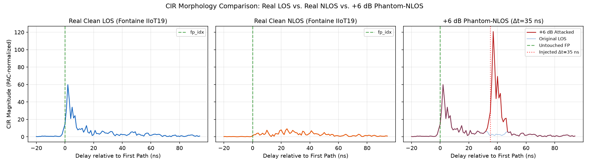
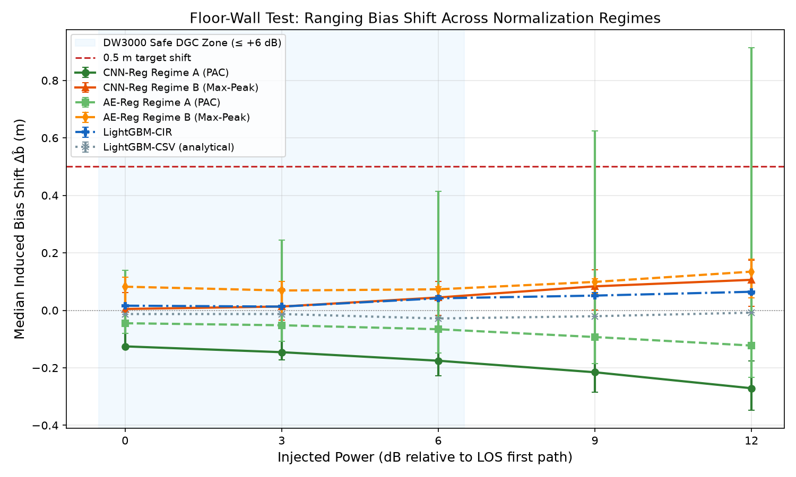
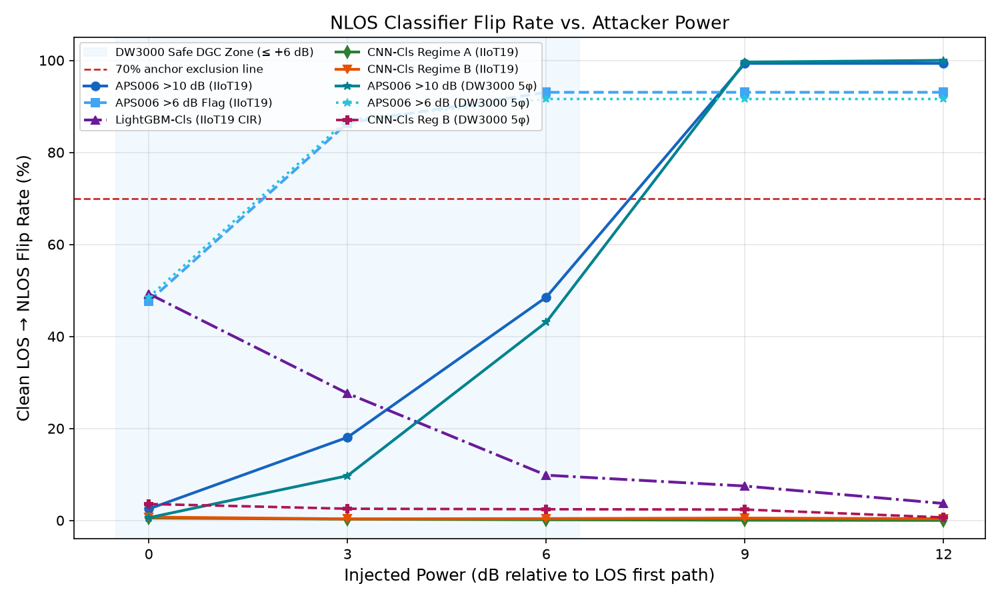
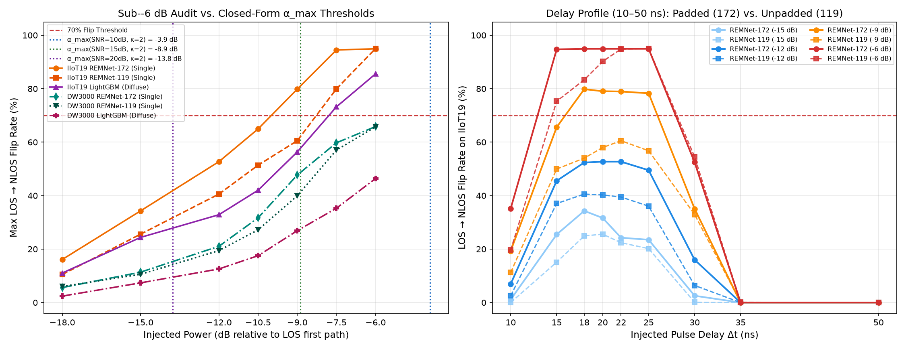
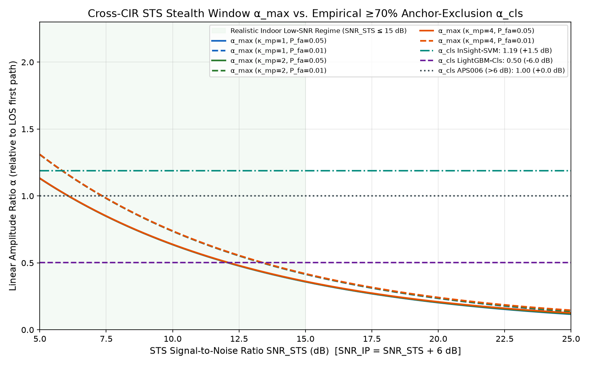
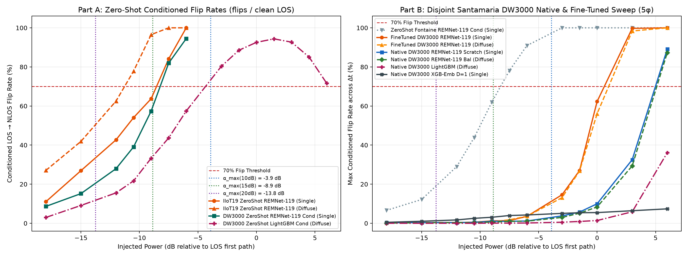
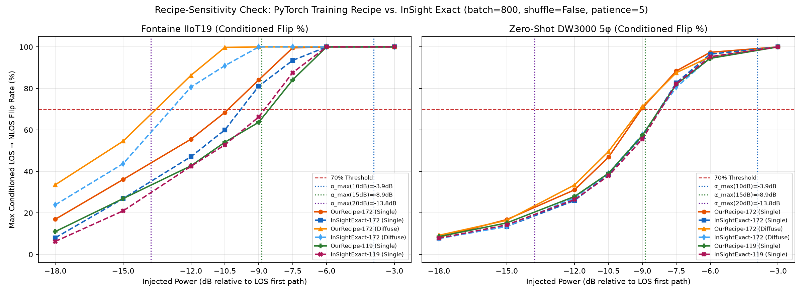

# Phantom NLOS: Simulation Study of Sub-Direct-Path UWB CIR False-NLOS Attacks & Classifier Robustness

> **Project Status: Completed & Archived (Simulation-Only)**
> This repository is in its final, frozen state. Development stops at offline waveform/CIR simulation and robustness auditing — no RF hardware experiments, over-the-air validation, or companion paper are planned.

Offline simulation and robustness benchmark evaluating whether injecting a **delayed, sub-direct-path multipath copy** of the legitimate Line-of-Sight (LOS) UWB pulse (`taps[0:24]` and first-path leading edge left untouched) can bias UWB ranging error regressors or trigger **false-NLOS anchor exclusion** across classical threshold rules, gradient-boosted trees, 1D-CNNs, and [InSight](https://github.com/LENS-TUGraz/InSight) (`REMNet`, `SVM`, `XGBoost`) baselines on **Fontaine IIoT19/IIoT20** (`DW1000`) and **Santamaria** (`DW3000`) Channel Impulse Response (CIR) captures.

---

## Key Simulation Findings

### 1. Indirect Ranging-Bias Reduction (`> 0.5 m` at `<= +6 dB`) — **Falsified**
* On anti-leakage `location_ID`-grouped Fontaine `IIoT19` test splits (`n = 2,874`; locations `{16, 18}`), strong ranging-bias regressors resist `> 0.5 m` shifts across `<= +6 dB` injections:
  * `CNN-Reg (Regime A, PAC-normalized)`: `-0.175 m` median shift at `+6 dB` (`0.4%` ASR `> 0.50 m`)
  * `CNN-Reg (Regime B, per-sample max-normalized)`: `+0.045 m` median shift at `+6 dB` (`0.0%` ASR `> 0.50 m`)
  * `LightGBM-Reg (CIR-derived features)`: `+0.042 m` median shift at `+6 dB` (`0.0%` ASR `> 0.50 m`)
* `AE-Reg (Regime A)` shows a localized `+0.464 m` spike (`45.6%` ASR `> 0.50 m`) at `Δt = 20 ns, +6 dB`. Diagnostic inspection (`src/diagnose_ae.py`, `results/ae_diagnosis.txt`) attributes this to an out-of-distribution latent-bottleneck extrapolation artifact (`11.2x` reconstruction MSE jump, `corr(Δz_bin1, Δb) = +0.968` in bin 1 `~20 ns/bin`) combined with its weaker clean fit (`RMSE = 334.0 mm` vs. `295.0 mm` for `CNN-Reg A`).

### 2. Sub-Direct-Path False-NLOS Anchor Exclusion & Architectural Divergence
While ranging regressors remain largely robust, **high-accuracy global-waveform NLOS classifiers flip strongly at negative relative injection powers** without altering the direct path:

| Classifier | Clean Test Acc (`IIoT19`) | Conditioned `>=70%` Flip Threshold (`IIoT19`, Single / Diffuse) | Zero-Shot `DW3000` (`5φ` Complex-IQ, Cond.) |
| :--- | :---: | :---: | :---: |
| **`InSight-REMNet-Cls` (172-tap)** | `0.984` | **`-10.35 dB`** / **`-13.54 dB`** | **`-9.03 dB`** / **`-9.09 dB`** |
| **`InSight-REMNet-119` (unpadded)** | `0.984` | `-8.54 dB` / `-11.27 dB` | `-8.23 dB` / `-8.32 dB` |
| **`LightGBM-Cls` (11 CIR features)** | `0.973` | `-5.76 dB` / `-8.11 dB` | `-4.45 dB` / `-4.35 dB` |
| **`InSight-SVM` (RBF, 8 features)** | `0.984` | `+1.5 dB` (`alpha_cls = 1.189` uncond.) | Peaks `79.2%` @ `+6 dB` (`uncond.`) |
| **`InSight-XGB-Full` (`D=6, T=100`)** | `0.961` | Never `>= 70%` (peaks `67.5%` uncond.) | Peaks `57.2%` @ `+6 dB` (`uncond.`) |
| **`InSight-XGB-Emb` (`D=1, T=30`)** | `0.934` | **Immune** (`<= 9.3%` max) | **Immune** (`<= 1.2%` max) |
| **`CNN-Cls` (157-tap, Regime B / A)** | `0.943` / `0.975` | `<= 27.1%` @ `-6 dB`, drops `<= 4.4%` at `>= +3 dB` | `3.6%` / `2.4%` mean (`<= 11.5%` @ `0 dB, 20 ns` in `B`) |

* **Closed-form STS multipath detectability bound** (`N_STS = 4096, M = 75, kappa_mp = 2, P_fa = 0.05`):
  `alpha_max = -3.91 dB` (`0.637`) at `SNR_STS = 10 dB`, and `-8.88 dB` (`0.360`) at `SNR_STS = 15 dB`. `InSight-REMNet` falls below `alpha_max` up to `10–15 dB` STS SNR on Fontaine `IIoT19` (and up to `10–15 dB` conditioned on zero-shot `DW3000`).
* **Sanity & sensitivity checks:**
  * Zero-injection identity control: `0.00%` flips across `IIoT19`, `IIoT20`, and `DW3000` (`max|w_zero - w_clean| = 0.0`).
  * First-path integrity: `taps[0:24]` remain bit-identical and simulated leading-edge detection stays `100%` locked at `ROLL_CIR = 20`.
  * Training-recipe sensitivity (`src/ablate_remnet_recipe.py`): Matching `InSight`'s exact Keras recipe (`batch=800, epochs=150, patience=5, shuffle=False, Adam eps=1e-7`) preserves clean accuracy (`0.9843` vs. `0.9840`) and keeps conditioned `IIoT19` / `IIoT20` / `DW3000` thresholds within `0.04–1.25 dB`.

### 3. Caveat & Native `DW3000` Proxy-Label Confound
* Santamaria `DW3000` lacks physical LOS/NLOS obstruction labels; native models trained in `src/audit_dw3000_native_remnet.py` use `APS006` proxy labels (`RXP - FPP < 6 dB` vs. `>= 10 dB`).
* Because a sub-`0 dB` multipath tail cannot raise total `RXP - FPP` past `10 dB`, proxy-trained native `DW3000` models simply recover the `~10 dB` energy-ratio threshold (`Native-DW3000-REMNet-119` reaches `>= 70%` flips at `+4.99` to `+5.18 dB` linear / `+6.0 dB` grid). Evaluating native `DW3000` robustness without proxy circularity would require physically labeled `DW3000` obstruction captures and OTA hardware testing, which are outside the scope of this archived simulation.

---

## Visual Summary










---

## Repository Layout

```text
.
├── README.md
├── requirements.txt
├── run_all.sh                          # Full 8-stage (or --core 3-stage) reproducible runner
├── results/                            # Final simulation CSVs, plots (.png), and audit reports (.txt)
└── src/
    ├── dataset.py                      # Grouped location_ID / punto_id splits & CIR/IQ loaders
    ├── features.py                     # Recomputed CIR waveform & APS006 feature extractors
    ├── injector.py                     # Untouched-first-path single & K=3 diffuse Phantom-NLOS injector
    ├── models.py                       # APS006, LightGBM, 1D-CNN, and Autoencoder architectures
    ├── inspect_data.py                 # Stage 1: Verify dataset files, schemas, and HDF5 shapes
    ├── train.py                        # Stage 2: Clean model training (Regimes A & B)
    ├── evaluate.py                     # Stage 3: Floor-wall sweep (IIoT19, IIoT20, DW3000)
    ├── diagnose_ae.py                  # Stage 4: AE-Reg (Regime A) OOD bottleneck diagnosis
    ├── eval_insight.py                 # Stage 5: InSight baselines, low-power sweep & alpha_max
    ├── audit_remnet_sub6db.py          # Stage 6: Identity test, sub--6 dB sweep & REMNet-119 ablation
    ├── audit_dw3000_native_remnet.py   # Stage 7: Conditioned zero-shot & native DW3000 proxy audit
    └── ablate_remnet_recipe.py         # Stage 8: PyTorch vs. InSight Keras recipe ablation
```

*(Note: Raw datasets under `data/`, model checkpoints under `models/`, local reference clone `external/InSight`, and `.venv/` are excluded via `.gitignore`.)*

---

## Datasets & Attribution

To re-run the pipeline from scratch, place the upstream datasets in:
* `data/fontaine/` — Fontaine et al. Industrial IIoT UWB datasets (`CIRsV2.hdf5`, `features_IIoT_19.csv`, `meta_IIoT_19.csv`, `meta_IIoT_20.csv`).
* `data/santamaria_dw3000/data/` — Santamaria real DW1000/DW3000 complex-IQ captures (`dw3000/`, `GroundTruth/`).
* Architecture & preprocessing reference: [LENS-TUGraz/InSight](https://github.com/LENS-TUGraz/InSight) (Gallacher et al., EWSN 2023). Preprocessing and PyTorch model twins are implemented self-contained in `src/eval_insight.py`.

## Reproducing Results

Tested with Python 3.12 (`3.12.16` in `.venv`: `torch 2.15`, `lightgbm 4.7`, `xgboost 3.4`, `scikit-learn 1.9`, `numpy 2.5`, `pandas 3.1`, `scipy 1.18`, `matplotlib 3.11`, `h5py 3.16`):

```bash
python3 -m venv .venv
.venv/bin/pip install -r requirements.txt

chmod +x run_all.sh
./run_all.sh          # Runs all 8 simulation, audit, and ablation stages
./run_all.sh --core   # Runs baseline Stages 1-3 only
```
